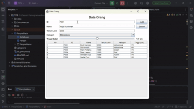
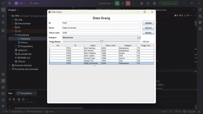
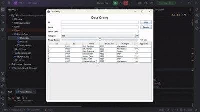
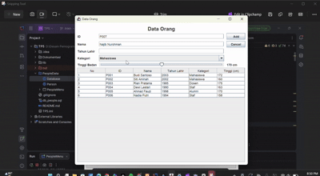
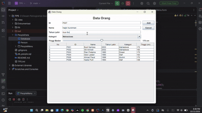
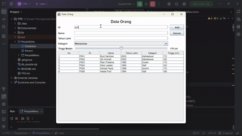

# TP5 DPBO - PeopleData (Java Swing GUI & Database MySQL)

Aplikasi CRUD data orang berbasis Java Swing (IntelliJ IDEA, Swing UI Designer) yang terintegrasi dengan basis data MySQL (`db_people`).

## 📌 JANJI
> Saya **Najib Nurohman** dengan NIM **2509653** mengerjakan **Tugas Praktikum 5** dalam mata kuliah **Desain Pemrograman Berorientasi Objek (DPBO)** untuk keberkahan-Nya maka saya tidak akan melakukan kecurangan seperti yang telah dispesifikasikan. Aamiin.

---

## 🛠️ Desain & Fungsi Program

| Berkas | Fungsi |
|---|---|
| `PeopleData/Person.java` | Class model data orang: atribut `id`, `nama`, `tahunLahir`, `kategori`, dan `tinggi` beserta getter/setter |
| `PeopleData/Database.java` | Class koneksi JDBC dan eksekusi query MySQL (`selectQuery` dan `insertUpdateDeleteQuery`) |
| `PeopleData/PeopleMenu.java` | Logika GUI, event handler, validasi input formulir, dan eksekusi CRUD ke database |
| `PeopleData/PeopleMenu.form` | Desain tata letak form antarmuka GUI (IntelliJ Swing UI Designer) |
| `db_people.sql` | Skrip pembuatan basis data `db_people`, tabel `person`, dan sampel data awal |
| `lib/mysql-connector-j-26.7.0.jar` | JDBC Driver untuk menghubungkan aplikasi Java dengan database MySQL |

- **Atribut Data:**
  - `ID`: Kode identifikasi unik setiap orang (Primary Key).
  - `Nama`: Nama lengkap.
  - `Tahun Lahir`: Tahun kelahiran (format angka).
  - `Kategori`: Kategori pilihan (`Mahasiswa`, `Dosen`, `Staf`, `Alumni`) menggunakan **JComboBox**.
  - **`Tinggi Badan`**: Nilai tinggi badan dalam cm (rentang 140–200 cm) menggunakan komponen non-JTextField yaitu **JSlider**.

---

## ⚙️ Konfigurasi Basis Data

1. **Impor Database:**
   Eksekusi skrip `db_people.sql` melalui command prompt MySQL atau fitur Import pada phpMyAdmin:
   ```sql
   source db_people.sql;
   ```
2. **Koneksi JDBC (`PeopleData/Database.java`):**
   - Host & Port: `127.0.0.1:3306`
   - Database: `db_people`
   - Username: `root`
   - Password: `""` (kosong secara default)

---

## 📖 Alur Program & Dokumentasi Demonstrasi

### 1. Tambah Data (Create)
- **Alur:**
  1. Pengguna mengisi `ID`, `Nama`, `Tahun Lahir`, memilih `Kategori` pada dropdown, dan menggeser slider `Tinggi Badan`.
  2. Klik tombol **Add**.
  3. Program memvalidasi seluruh input. Jika valid dan ID belum ada di database, program mengeksekusi `INSERT INTO person ...`.
  4. Tabel `peopleTable` langsung disegarkan (refresh) menampilkan data baru, form dibersihkan, dan dialog pesan `"Data berhasil ditambahkan"` ditampilkan.



---

### 2. Ubah Data (Update)
- **Alur:**
  1. Pengguna mengklik salah satu baris data pada tabel.
  2. Data dari baris yang dipilih otomatis dimuat ke seluruh komponen formulir, teks tombol aksi berubah menjadi **Update**, dan tombol **Delete** ditampilkan.
  3. Pengguna mengubah data yang diinginkan lalu menekan tombol **Update**.
  4. Program mengeksekusi `UPDATE person SET ... WHERE id = ?`.
  5. Tabel diperbarui dengan data termutakhir, formulir di-reset ke mode awal, dan dialog `"Data berhasil diubah"` ditampilkan.



---

### 3. Hapus Data (Delete)
- **Alur:**
  1. Pengguna memilih baris data yang ingin dihapus pada tabel.
  2. Pengguna menekan tombol **Delete**.
  3. Muncul dialog konfirmasi: *"Yakin ingin menghapus data ini?"*.
  4. Jika memilih **Yes**, query `DELETE FROM person WHERE id = ?` dijalankan ke database.
  5. Data terhapus dari tabel, form dikosongkan, tombol Delete disembunyikan kembali, dan muncul notifikasi `"Data berhasil dihapus"`. Jika memilih **No**, proses dibatalkan.



---

### 4. Validasi: Field Kosong (Error Tidak Diisi)
- **Alur:**
  1. Pengguna menekan tombol **Add** atau **Update** saat ada field yang belum diisi (ID kosong, Nama kosong, Tahun Lahir kosong, atau Kategori masih `???`).
  2. Sistem menolak proses penyimpanan dan memunculkan pop-up error: *"Semua field harus diisi!"*.



---

### 5. Validasi: Format Tahun Lahir (Error Bukan Angka)
- **Alur:**
  1. Pengguna menginputkan karakter huruf/simbol ke dalam field **Tahun Lahir**.
  2. Saat tombol **Add** atau **Update** ditekan, program menangkap `NumberFormatException`.
  3. Sistem memunculkan pop-up error peringatan: *"Tahun lahir harus berupa angka!"*.



---

### 6. Validasi: ID Duplikat (Error Kode Sama)
- **Alur:**
  1. Pengguna mencoba menambahkan data baru dengan ID yang sudah tersimpan di database, atau mengubah ID menjadi ID milik data lain yang sudah ada.
  2. Sistem mengecek ketersediaan ID melalui fungsi `isIdExists()` menggunakan query `SELECT 1 FROM person WHERE id = ?`.
  3. Karena ID telah terdaftar, sistem menolak input dan memunculkan pesan error: *"ID '[id]' sudah digunakan!"*.


